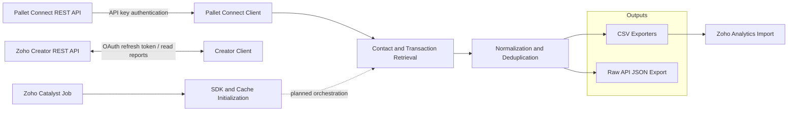

# Paradigm Pallet Catalyst Integration

## Document Purpose

This document describes the architecture and behavior of the Paradigm Pallet Connect integration. It is intended to help developers, administrators, analysts, and stakeholders understand how Pallet Connect data is retrieved, normalized, exported, and prepared for use in Zoho products.

## Executive Summary

The repository is a Node.js integration project deployed as a Zoho Catalyst Job function. Its purpose is to automate retrieval and synchronization of transaction data from Pallet Connect and to make the data available for reporting and downstream Zoho workflows.

The implementation currently has two major technical surfaces:

1. A standalone Node.js test and export workflow that authenticates with Pallet Connect, retrieves contacts and transactions, transforms records, removes duplicates, creates CSV files, and can upload selected tables to Zoho Analytics.
2. A Catalyst Job function shell that initializes the Catalyst SDK, Cache, and job context but does not yet contain the complete production synchronization orchestration.

Zoho Creator integration code is primarily read-oriented at present: it authenticates and retrieves Creator reports. The repository does not yet contain a complete Creator write/sync workflow.

## Business Objectives

The integration is designed to:

- Retrieve Pallet Connect contacts and transaction history.
- Support date-range and optional facility filtering.
- Paginate large API result sets.
- Synchronize or export data for all contacts.
- Deduplicate transactions before reporting.
- Separate transaction headers, transaction detail lines, contact attributes, and daily summaries.
- Preserve the original API response for audit and troubleshooting.
- Upload Analytics-ready CSV data to Zoho Analytics.
- Provide standalone scripts for authentication and API testing.

## Technology Stack

| Area | Technology |
|---|---|
| Runtime | Node.js; Catalyst deployment configured for Node 22 |
| Hosting | Zoho Catalyst Job function |
| Source system | Pallet Connect REST API |
| Destination/reporting | Zoho Analytics REST API |
| Read destination | Zoho Creator REST API |
| Configuration | Environment variables and `.env` files |
| Catalyst SDK | `@zcatalyst/auth`, `@zcatalyst/cache` |
| Output format | CSV and JSON |
| Package model | CommonJS modules |

## Repository Layout

| Path | Responsibility |
|---|---|
| `catalyst.json` | Links the repository to the Catalyst function source directory. |
| `.catalystrc` | Links the workspace to the Catalyst project and active Development environment. |
| `functions/pallet_connect_transaction_sync_function/index.js` | Catalyst Job function entry point. |
| `functions/pallet_connect_transaction_sync_function/catalyst-config.json` | Job deployment configuration and Node stack. |
| `functions/pallet_connect_transaction_sync_function/clients/` | Authentication and API client implementations. |
| `functions/pallet_connect_transaction_sync_function/services/` | Intended synchronization coordination layer. |
| `functions/pallet_connect_transaction_sync_function/transformers/` | Intended or currently used CSV transformation functions. |
| `functions/pallet_connect_transaction_sync_function/config/` | Facility and integration configuration. |
| `functions/pallet_connect_transaction_sync_function/exports/` | Generated JSON and CSV artifacts. |
| `functions/pallet_connect_transaction_sync_function/test-*.js` | Standalone integration test and validation scripts. |
| `functions/pallet_connect_transaction_sync_function/test_csv.js` | Main Analytics-oriented normalization and CSV export implementation. |

## High-Level Architecture

The intended runtime flow is:

1. Authenticate with Pallet Connect.
2. Load contacts, dates, and optional facility parameters.
3. Retrieve transactions, including paginated result sets.
4. Normalize and enrich the returned records.
5. Produce table-ready CSV and JSON outputs.
6. Import approved data into Zoho Analytics.
7. Optionally read existing records from Zoho Creator for reconciliation.

## Catalyst Deployment Architecture

The repository is linked to the `Pallet-Connect-Transaction-Sync` Catalyst project in the Development environment.

The function is configured as:

- Function name: `pallet_connect_transaction_sync_function`
- Function type: Job
- Runtime: Node.js 22
- Entry point: `index.js`

Catalyst Job functions receive a job request and execution context. The current entry point initializes:

- Catalyst authentication from the execution context.
- Catalyst Cache.
- Project, job, metadata, capacity, and supplied job parameter information.

The entry point currently closes successfully after initialization and logging. It does not yet execute the Pallet Connect extraction or export workflow.

## Pallet Connect Integration

### Authentication

Pallet Connect authentication uses `PALLET_CONNECT_API_KEY`.

The authentication client:

1. Loads the API key from environment variables.
2. Sends it as a multipart form field to `/validate_key`.
3. Expects `success === 1` and a returned token.
4. Returns a bearer token for subsequent requests.

All secure retrieval calls use `Authorization: Bearer <token>`.

### Base URL

The Pallet Connect API client uses:

`https://sf1api.palletconnect.com/api`

### Contacts

The contact client calls:

`GET /secure/contacts`

It validates HTTP status and Pallet Connect's `success` field, then returns the `data` array.

Contacts are used both as the customer dimension for transaction enrichment and as a separately exported Analytics table.

### Facilities

The facility client calls:

`GET /secure/facility_list`

It expects an array response and allows transactions to be optionally restricted to a facility through `facility_id`.

The repository's `config/facilities.js` currently has no active facility mapping implementation.

### Transactions

The transaction search client calls:

`GET /secure/transactions/search`

Supported parameters include:

| Parameter | Purpose |
|---|---|
| `contact_id` | Limit results to one Pallet Connect contact. |
| `start_date` | Include transactions starting on or after this date. |
| `end_date` | Include transactions through this date. |
| `facility_id` | Optionally restrict results to a facility. |
| `offset` | Skip a number of result records. |
| `limit` | Number of records requested in one page. |

The default page size is 20. Pagination functions continue requesting pages until the API returns fewer records than the requested limit.

The repository also supports retrieving transactions:

- One contact at a time.
- Across all contacts.
- Through a test-only endpoint that does not require `contact_id`.

## Rate-Limit Handling

When a per-contact transaction request receives an HTTP 429 response, the all-contacts workflow retries up to five attempts.

The retry delay uses exponential backoff:

- Base: 35 seconds
- Maximum: 120 seconds
- A 100 millisecond delay is applied between contact requests

The implementation distinguishes rate-limit failures from other errors and stops immediately for non-429 failures.

## Transaction Detail Retrieval

Each transaction can include a reference number. The repository provides:

`GET /secure/transactions/get/{referenceNumber}`

This endpoint retrieves detailed transaction data. Its response is validated for HTTP success and Pallet Connect's `success === 1` flag.

## Normalization and Analytics Export

The primary export implementation is `test_csv.js`.

### Input

The exporter accepts:

- A transaction array.
- A contact array.
- A start date.
- An end date.

### Contact Rows

Contacts are normalized into `analytics_contacts.csv` with fields including:

- Contact ID and name.
- Parent contact ID.
- Location label.
- Salesperson ID.
- Email and phone.
- Address, city, state/province, postal code, and country.
- Company, deletion, and hold flags.

### Transaction Header Rows

The transaction table is deduplicated using a key composed of facility ID and transaction ID.

Duplicate transactions are removed and counted.

`analytics_transactions.csv` includes:

- Pallet Connect transaction ID.
- Facility and contact identifiers/names.
- Transaction date and time.
- Transaction type and status.
- Slip, invoice, POD, purchase order, and trailer numbers.
- State/province.
- Quantity and value fields.
- Parent transaction ID.
- Pallet Connect update and deletion metadata.
- Source URL.

### Transaction Detail Rows

`analytics_transaction_details.csv` includes one row per transaction line.

Detail fields include:

- Transaction and detail IDs.
- Facility and contact identifiers.
- Date, transaction type, and status.
- Stock item ID and name.
- Quantity and unit price.
- Line amount and discount fields.
- Board feet and net quantity.
- Income and expense account codes.
- A JSON representation of the original detail record.

A transaction is counted as missing details when it has no `transaction_details` array or the array is empty.

### Daily Summary Rows

`analytics_daily_summary.csv` is aggregated at the grain:

`date + facility + customer + transaction type + status + stock item`

It contains:

- Transaction count.
- Line count.
- Total quantity.
- Total line amount.

Header totals are not summed in this aggregation. Financial values come from detail rows to avoid multiplying header totals by the number of line items.

### CSV and JSON Outputs

The exporter writes files into `functions/pallet_connect_transaction_sync_function/exports/`:

| File | Content |
|---|---|
| `analytics_transactions.csv` | One normalized row per unique transaction. |
| `analytics_transaction_details.csv` | One normalized row per transaction detail line. |
| `analytics_contacts.csv` | One row per contact. |
| `analytics_daily_summary.csv` | Daily analytical summary grouped by dimensions and item. |
| `api_response.json` | Original contacts and transactions plus date parameters. |

CSV files are UTF-8 and include a BOM for spreadsheet compatibility. String fields are escaped and all object values are serialized when used in export columns.

## Standalone CSV Transformations

The `transformers/` directory also contains simpler CSV helpers:

- `createContactCSV.js` writes a generic contact table to `exports/contacts.csv`.
- `createTransactionCSV.js` writes a generic transaction table to `exports/transactions.csv`.

These helpers are separate from the richer `test_csv.js` Analytics export.

The repository also contains `test-api.js`, which performs an end-to-end extraction and calls `exportAnalyticsData`.

## Zoho Analytics Integration

Zoho Analytics integration is implemented in `clients/zohoAnalyticsClient.js`.

### Authentication

It obtains an access token using Zoho OAuth refresh credentials:

- `ZOHO_REFRESH_TOKEN` or the Analytics-specific refresh token, depending on client usage.
- `ZOHO_CLIENT_ID`
- `ZOHO_CLIENT_SECRET`
- `ZOHO_ACCOUNTS_URL`
- `ZOHO_ANALYTICS_ORG_ID`

The Analytics client exchanges refresh credentials for an access token at the configured Zoho Accounts URL.

### Upload Behavior

CSV uploads use the Zoho Analytics REST API.

The upload is configured as:

- Import type: `updateadd`
- File type: CSV
- Automatic column identification
- Abort on import errors
- Matching column based update/add behavior

The available upload functions are:

- Contacts: `analytics_contacts.csv`, matched by `Contact_ID`
- Transactions: `analytics_transactions.csv`, matched by `PC_Transaction_ID`

The standalone `test-analytics.js` script calls both upload functions.

The import API validates that:

- The CSV file exists.
- It contains at least one data row.
- It contains the required matching column.

## Zoho Creator Integration

Zoho Creator integration currently consists of authentication and report-read functions.

The `zohoCreatorAuth.js` client exchanges:

- `ZOHO_CLIENT_ID`
- `ZOHO_CLIENT_SECRET`
- `ZOHO_REFRESH_TOKEN`

for a Zoho OAuth access token.

`zohoCreatorGetters.js` supports:

- Fetching Creator report records.
- Fetching a record by Creator record ID.
- Fetching records with Creator criteria.
- Paginating through all report records.

The test script checks reports named:

- `All_Contacts`
- `All_Transactions`
- `All_App_Logs`

No complete Creator create/update write client is implemented in the current repository. `transactionTransformer.js` is only a placeholder comment and does not contain a data mapping implementation.

## Configuration and Secrets

Environment configuration is loaded using `dotenv`.

Expected variables include:

| Variable | Used by |
|---|---|
| `PALLET_CONNECT_API_KEY` | Pallet Connect authentication |
| `ZOHO_CLIENT_ID` | Zoho OAuth clients |
| `ZOHO_CLIENT_SECRET` | Zoho OAuth clients |
| `ZOHO_REFRESH_TOKEN` | Zoho Creator authentication |
| `ZOHO_ANALYTICS_REFRESH_TOKEN` | Zoho Analytics authentication |
| `ZOHO_ACCOUNTS_URL` | Zoho Accounts endpoint |
| `ZOHO_CREATOR_OWNER` | Zoho Creator account owner |
| `ZOHO_CREATOR_APP` | Zoho Creator application name |
| `ZOHO_CREATOR_API_URL` | Optional Creator API base override |
| `ZOHO_ANALYTICS_ORG_ID` | Zoho Analytics organization header |

`.env` files and key files are excluded by `.gitignore`. Secrets must not be committed or logged.

## Test and Validation Scripts

| Script | Purpose |
|---|---|
| `test-tokens.js` | Verifies environment credential availability. |
| `test-contacts.js` | Tests Pallet Connect contact retrieval. |
| `test-api.js` | Performs extraction and Analytics CSV export. |
| `test-analytics.js` | Uploads contact and transaction CSV files to Analytics. |
| `test-creator.js` | Tests Creator report and record retrieval. |
| `test_csv.js` | Provides the data normalization/export module and standalone test entry path. |
| `createTransactionCSV.js` | Standalone transaction CSV generator. |
| `createContactCSV.js` | Standalone contact CSV generator. |

There is no formal automated test runner configured. The root `package.json` has a placeholder `npm test` script, and integration behavior is validated by standalone scripts.

## Current Execution Status

The repository is not yet a complete single-entry-point production synchronization application.

### Implemented

- Pallet Connect bearer authentication.
- Contact retrieval.
- Facility retrieval.
- Paginated transaction retrieval.
- All-contacts and per-contact transaction retrieval.
- 429 retry logic.
- Transaction detail retrieval.
- Contact and transaction CSV normalization.
- Analytics-ready transaction, detail, contact, and summary exports.
- Duplicate detection and counting.
- Original API JSON preservation.
- Zoho Analytics update/add upload.
- Zoho Creator OAuth authentication and report reads.
- Catalyst SDK, cache, and job metadata initialization.

### Not Yet Implemented as a Complete Workflow

- Catalyst `index.js` orchestration that calls the extraction and export modules.
- Automated scheduling or job parameter routing.
- Complete Creator write/sync logic.
- Complete service-layer implementations in `services/`.
- Verified facility configuration in `config/facilities.js`.
- Approval mapping for `Item_Category`.
- Salesperson name lookup.
- A formal test suite and CI validation.
- End-to-end deployment validation for the Catalyst Job.

## Important Data Quality Rules

1. Transactions are deduplicated by facility and Pallet Connect transaction ID.
2. Header totals and detail totals are modeled separately.
3. Daily summaries use detail line values, not header totals.
4. Missing transaction detail arrays are reported, not silently replaced with a zero line.
5. The original Pallet Connect response is retained in `api_response.json`.
6. Numeric fields are converted when possible and become `null` for invalid values.
7. Missing dates and invalid placeholder dates are normalized to `null`.
8. Stock item category mapping requires a reviewed Pallet Connect-to-Creator mapping before automation.

## Operational Risks and Considerations

- **Partial orchestration:** The deployed Job shell is not yet the active data pipeline.
- **Long-running extraction:** Retrieving for many contacts can exceed job limits; pagination and delays must be considered in scheduling.
- **Rate limits:** API throttling requires retries and sufficient timeout capacity.
- **Credential rotation:** OAuth refresh tokens and Pallet Connect API keys require secure storage and monitored expiration behavior.
- **Schema drift:** Pallet Connect nested response fields may change; export code should validate or version schemas.
- **Duplicate scope:** Deduplication uses transaction ID and facility ID, but downstream systems require consistent matching keys.
- **Analytics matching:** Import success depends on matching column names and existing view definitions.
- **Missing category mapping:** The Item Category field is currently `null` and should not be used for classification until approved mapping exists.
- **Environment configuration:** Catalyst and local script credentials are not interchangeable.

## Recommended Production Flow

A production-ready implementation should:

1. Parse job parameters for date range, facility selection, and destination mode.
2. Authenticate once per run.
3. Retrieve contacts and transactions through reusable service functions.
4. Fetch transaction details only when required or cacheable.
5. Transform data into Analytics and Creator schemas.
6. Deduplicate consistently across each run and destination.
7. Upload or reconcile records transactionally where supported.
8. Write run counts, errors, and timing to Catalyst Cache or application logs.
9. Close the Job with success or failure based on the complete workflow.
10. Emit an auditable summary and retain source JSON for debugging.

## Development Conventions

- Use CommonJS `require` and `module.exports` consistently with the current function package.
- Keep API authentication, retrieval, transformation, and export responsibilities separated.
- Preserve HTTP and API error details for diagnostics.
- Validate both HTTP status and provider-specific success fields.
- Paginate large result sets.
- Avoid adding line-derived totals to header-level financial totals.
- Keep secrets in ignored environment files.
- Add focused tests when extraction, matching, or aggregation behavior changes.

## Glossary

| Term | Meaning |
|---|---|
| Catalyst | Zoho serverless and cloud application platform. |
| Job | A Catalyst background function type used for scheduled or capacity-oriented work. |
| Pallet Connect | Source system that stores pallet inventory and transaction data. |
| Facility | A physical location or site represented by a Pallet Connect `facility_id` or site. |
| Contact | A customer or company record in Pallet Connect. |
| Transaction Header | Summary fields describing a transaction. |
| Transaction Detail | Individual stock or service line within a transaction. |
| Daily Summary | Aggregation of detail values by date and business dimensions. |
| Update/add | A destination import mode that matches existing records and creates missing records. |
| Zoho Creator | Low-code business application platform and reporting/source system. |
| Zoho Analytics | Business intelligence platform used for uploaded data and analysis. |
